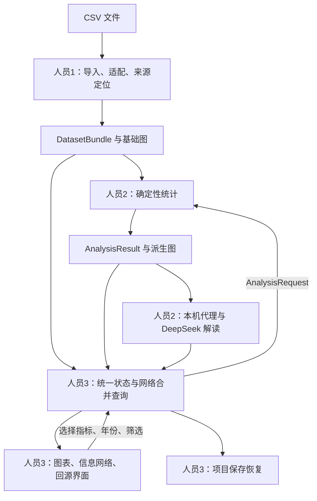

# 共同上下文 v1.0

> **全员必读。** 初始目标与持续口径；阶段状态已在仓库首页更新。 先核对 [仓库首页](../README.md)，并按 [交接必读总索引](README.md) 阅读本角色新增材料。

## 1. 已确认目标与现状

本项目对应校园比赛 T3「数据洞察官——从描述统计到文字解读」。用户希望迁移已有 Learning Agent 的来源定位、原始证据保持、人读输出与机器索引分离思想，形成经济数据的信息网络。

首版目标：上传 CSV → 规范数据 → 建立明确关系 → 程序统计 → 三类图表 → 真实 AI 解读 → 点击结论回查原始依据。信息网络必须支持操作和追溯，不仅是装饰图。

初始交接基线472d151只有交接材料、原始CSV和团队核验样例，当时尚无应用实现。此后人员3已在dev/app交付实现与自测，人员4已核验初始材料；最新证据入口见仓库README。三域真实完整流程、真实API和集成产品审计仍未完成。

## 2. 固定范围

- 总体开发目标 150 分钟；三名开发并行，一名独立审计。总控仅协调，不承担第四份代码工作。
- 运行地点为一台主机的本地浏览器；四台电脑用于写代码，不提供四个分布式运行服务。
- 三个数据域都适配：D1 居民收支、D2 企业财务、D3 汽车销量。原始 CSV 共 58 份，清单见 [manifest](../data/manifest.json)。
- 三类数据分别计算；只有共同键和口径明确时才在域内连接表格。跨领域不自动建立因果关系。
- 实时 AI 必须用真实 DeepSeek 官方 API。用户或队员准备账号、密钥与可用额度，人员2配置并验证。开发助手登录不等于应用已有接口。
- 本地项目保存恢复是必做。首版不支持 PDF/Word 上传、开放问答、向量检索、图数据库、预测、交易建议或保险解释。

## 3. 系统分层

六类图节点：`source` 来源、`dataset` 数据集、`indicator` 指标、`scope` 分析范围、`calculation` 计算、`finding` 发现。地区、年份、行业是分析范围和字段维度；首版不把每个单元格画成节点。

原始观测值保留在表格，计算保留有效记录编号及原始位置映射。来源图只登记材料；后续结论使用引用连接，不反写原始数据。默认显示选中对象的局部网络，可展开来源详情。

## 4. 三类数据的解释边界

| 数据域 | 适配与默认范围 | 必须说明 |
|---|---|---|
| D1 | 年份宽表转规范数据，按地区＋年份连接；默认2024年 | 全体/城镇/农村和单位分别保留；31省简单均值不是全国人口加权均值；停更年份保留缺失 |
| D2 | 股票代码保留文本；默认FY2025，明确筛选6位代码60/00/30/68开头 | 原始表混合市场，过滤有记录；缺失行业显示未分类；亏损与ST不静默删除；数据为后续披露版本，不做历史可交易断言 |
| D3 | 分别识别车企榜、车型榜、CPCA结构/总量；榜单默认2026-08 | Top50不是全市场；原环比列禁止用于结论；单月/累计、产量/批发/零售/出口、辆/万辆/百分数不混算 |

普通 CSV 使用 `generic-csv` 并允许确认字段角色与单位；未知含义明确标记。三类域的适配器名及文件问题以 manifest 为据。适配文件名只是入口线索，字段和表内容需要核对。

## 5. AI 与技术方案

技术栈：React＋TypeScript＋Vite；Papa Parse；ECharts同时绘制统计图和信息网络；Node本机模型代理。主机已发现 Node 22.23.2；其他电脑在正式开发开始前对齐运行环境。依赖版本由人员3统一锁定，其他人不自行改依赖文件。

AI 只接收当前分析的确定性结果、指标含义、范围及局限。每条解读引用结果编号；数字通过已计算结果插入。程序必须核对引用存在及属于当前分析，不能把引用有效等同于所有文字自动正确。

默认服务为 https://api.deepseek.com ，模型配置为 `deepseek-flash`；官方接口说明 https://api-docs.deepseek.com/ （规划核对日期2026-10-25）。人员2在正式开发前20分钟完成一次真实调用。首次配置时按实际官方能力验证，不从开发助手配置中擅取密钥。

接口失败保留统计与图谱，明确报错和重试；AI验收仍为未通过。项目恢复展示历史AI记录及时间，不自动重发模型请求。

## 6. 开发与交付阶段

首次接收：阅读交接包，分别回复职责、输入、输出、依赖、问题、下一阶段交付物。明确进入开发阶段后按下表执行；已在开发或审计中的角色按实际阶段继续，不重走只读首轮。

| 开发时间 | 目标 |
|---|---|
| 0–20分钟 | 人员3公共骨架与接口桩；人员1核对适配；人员2真实API探通；人员4独立验收准备 |
| 20–60分钟 | 三名开发按同一契约并行，最晚60分钟开始第一次真实集成 |
| 60–90分钟 | 上传→统计→图表→网络→AI→来源走通，三类逐一联调 |
| 90–120分钟 | 保存恢复、错误状态、真实数据口径修复 |
| 120–150分钟 | 功能冻结，审计、修复、复验和主机演示 |

工期是目标，不是保证。账号、额度、网络和其他电脑环境尚未验证；不得以未经实测的完成率代替进度。
